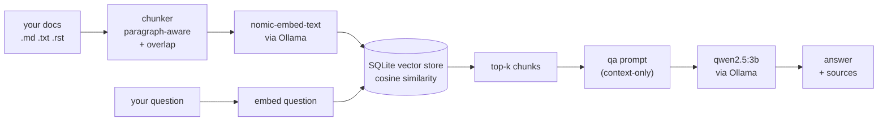

# 🦙 Ollama RAG Assistant

[](LICENSE)
[](https://www.python.org/)
[](https://ollama.com)

Ask questions about your own documents with a fully local, keyless Retrieval-Augmented Generation pipeline. Install once, index your docs, ask — answers are generated by a local model and grounded **only** in what you indexed.

No API keys · no data leaves your machine · no external vector database.

```console
$ rag-assistant index samples/
embedding 6 chunks from 2 document(s) via nomic-embed-text ...
indexed 6 chunks (store now holds 6)

$ rag-assistant ask "What embedding model does this project use, and how big is its vector?"
The embedding model used is `nomic-embed-text` and its vector is 768-dimensional.

sources:
  - samples/ollama-cheat-sheet.md
  - samples/ollama-rag-assistant.md
```

*(This is the real output of the commands below against the bundled `samples/` docs.)*

## How it works



1. `rag-assistant index <path>` chunks documents on paragraph boundaries (with configurable overlap), embeds each chunk with `nomic-embed-text` and stores everything in a plain SQLite file.
2. `rag-assistant ask <question>` embeds your question, ranks chunks by cosine similarity and builds a strict *"answer only from the context"* prompt.
3. The chat model (default `qwen2.5:3b`) answers with inline source citations.

## Quickstart

```bash
# 1. Install Ollama and pull the models (one time)
#    get it from https://ollama.com, then:
ollama pull nomic-embed-text   # ~275 MB embeddings
ollama pull qwen2.5:3b         # ~2 GB chat model

# 2. Install this package
pip install .
# or for development / tests:  pip install -e .[dev]

# 3. Index your documents
rag-assistant index /path/to/my/docs

# 4. Ask
rag-assistant ask "what does the deployment checklist say?"
```

> **Windows note:** `pip` installs the `rag-assistant` launcher into your user `Scripts` directory, which may not be on `PATH`. Either add it to `PATH` or use `python -m rag_assistant.cli <command>` — the commands are identical.

## CLI reference

| Command | What it does |
| :--- | :--- |
| `rag-assistant index <path>` | Read a file or directory, chunk, embed and store it |
| `rag-assistant ask <question> [--top-k N]` | Answer a question from the indexed docs |
| `rag-assistant stats` | Show chunks / sources / vector dimension in the store |
| `rag-assistant clear` | Wipe the store |
| `rag-assistant serve [--port 8765]` | Start the optional local web UI |
| `rag-assistant --version` | Print the version |

Global options (before the subcommand): `--db <path>` selects the SQLite store location (default `./rag-assistant.db`, or the `RAG_DB` environment variable).

Useful flags: `index --chunk-size 600 --overlap 80 --embed-model nomic-embed-text`, `ask --model qwen2.5:3b`.

**Model choice:** `qwen2.5:3b` answers quickly on CPU; `qwen3:8b` (if pulled) gives noticeably stronger answers on complex sources at the cost of latency.

## Web UI

```bash
pip install .[web]
rag-assistant serve --port 8765
# then open http://localhost:8765
```

A chat page that asks your indexed documents. Everything runs on localhost against the same store and Ollama server as the CLI.

## Architecture

```
src/rag_assistant/
├── chunker.py    # paragraph-aware chunking: packs up to `size`, hard-splits long paragraphs, one overlap pass
├── store.py      # SQLite store of chunks + JSON-serialized vectors; cosine similarity in pure Python
├── ollama.py     # tiny client for the Ollama HTTP API (stdlib urllib) - /api/embeddings and /api/chat
├── rag.py        # retrieve → prompt → grounded answer with source citations
├── cli.py        # `rag-assistant` command line
└── web.py        # optional FastAPI app: single-page chat UI (`--port 8765`), /api/ask, /api/stats
```

No heavy ML dependencies in the core. Embeddings and chat happen server-side in Ollama; this package is glue + storage + retrieval.

## Testing

```bash
pip install -e .[dev]
python -m pytest
```

37 tests cover chunking, the store, the retrieval pipeline, the CLI and the web app. All Ollama calls are mocked or stubbed — **the suite runs with no network access and no GPU**, and passes in under 2 seconds. The end-to-end demo above was executed against real Ollama models.

## Limitations (honest)

- Retrieval is brute-force cosine over all stored chunks. Great for a personal knowledge base (thousands of chunks); not a substitute for a purpose-built vector database at millions of documents.
- Answers are only as good as the retrieved context. If the answer is not in the indexed documents, the model is instructed to say so rather than invent it.
- Models must be pulled separately (`ollama pull …`). Nothing is downloaded by installing this package.

## License

MIT — see [LICENSE](LICENSE).
